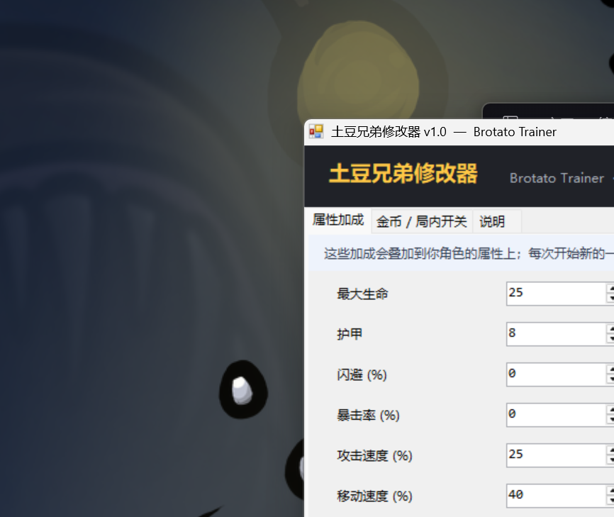

# 土豆兄弟修改器 / Brotato Trainer

一个给《土豆兄弟》(Brotato) 用的独立修改器。**不修改游戏本体**，随时可完整卸载。



## 功能

### 16 项属性加成

| 属性 | 说明 |
|---|---|
| 最大生命 | 直接加到生命上限 |
| 护甲 | 减伤 |
| 闪避 (%) | 躲开攻击的概率（游戏上限 60） |
| 暴击率 (%) | 暴击概率 |
| 攻击速度 (%) | 100 = +100% |
| 移动速度 (%) | 移速加成 |
| 幸运 | 影响掉落品质 |
| 收获 | 影响金币收益 |
| 生命回复 | 每秒回血 |
| 吸血 (%) | 攻击吸血概率 |
| 近战伤害 / 远程伤害 / 元素伤害 | 对应伤害加成 |
| 伤害加成 (%) | 全局伤害 |
| 射程 | 武器射程 |
| 工程学 | 炮台类道具强度 |

### 金币与局内开关

- 金币数量 / 维持金币（不够自动补满）
- 起始波次（1-100）
- 商店免费刷新次数
- 无敌、一击必杀、敌人静止、不刷怪
- 游戏速度（20% - 300%）

改完**不需要重启游戏**，保存后约 1 秒热更新，正在打的这一局也会立刻用上新数值。

## 使用

1. 下载 [releases/BrotatoTrainer.exe](releases/BrotatoTrainer.exe)
2. 双击运行，程序会自动找到游戏目录（认不出就点「浏览...」手动选）
3. 点 **「1. 安装修改器」**
4. 调参数 → 点 **「2. 保存并生效」**
5. 点 **「3. 启动游戏」**，进入一局后约 1 秒生效

卸载：点 **「卸载修改器」**，删除 BrotatoTrainer 目录和 override.cfg，游戏恢复原样。**存档不受影响。**

## 原理

游戏用 Godot 3 引擎，自带 ModLoader 6.3.0，但实测无法从创意工坊或 res://mods-unpacked 加载本地 mod。

本项目改用 Godot 的 override.cfg autoload 注入机制：

```ini
[autoload]

ZZTrainer="*res://BrotatoTrainer/trainer.gd"
```

游戏会把 exe 所在目录当作可写 res:// 根，从而加载我们放进去的 GDScript。脚本在运行时通过游戏自身的 API 修改数值：

- `RunData.add_stat(hash, delta, player_index)` — 加属性
- `RunData.add_gold()` / `add_xp()` — 金币 / 经验
- `DebugService.invulnerable` / `one_shot_enemies` / `nullify_enemy_speed` — 开关
- `Player.disable_hurtbox()` — 无敌生效

脚本每 0.3 秒检查 config.json 的修改时间，实现热更新。

## 项目结构

```
src/Program.cs      C# WinForms 界面 + 安装逻辑 + 内嵌脚本（csc 编译）
src/trainer.gd      GDScript 运行时模块（会被嵌入到 exe）
releases/           编译好的 exe
docs/               截图
build.ps1           一键编译
```

## 自己编译

只需要 Windows 自带的 .NET Framework 编译器，无需安装 Visual Studio：

```powershell
.\build.ps1
```

输出 releases\BrotatoTrainer.exe。

## 自检

```powershell
.\releases\BrotatoTrainer.exe --selftest
```

自动检测游戏目录、安装一遍、回读校验，结果写到 _selftest_result.txt。

## 兼容性

- Brotato 1.1.15.4（Steam 版）
- Windows 10 / 11 x64
- 只影响本地单人游戏

## 已知限制

- 部分属性有游戏内上限（如闪避 60%），超过不会更有效
- 游戏大版本更新后如果失效，重新点一次「安装修改器」即可
- 不改存档文件，所以每局开始时会按配置重新应用

## 许可

MIT License